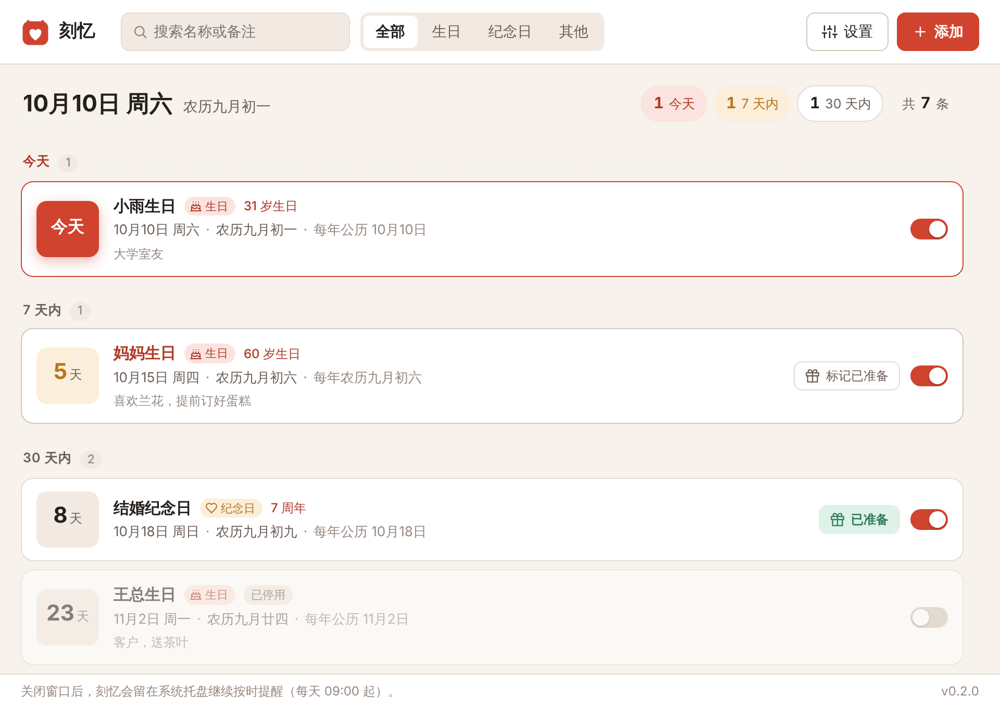
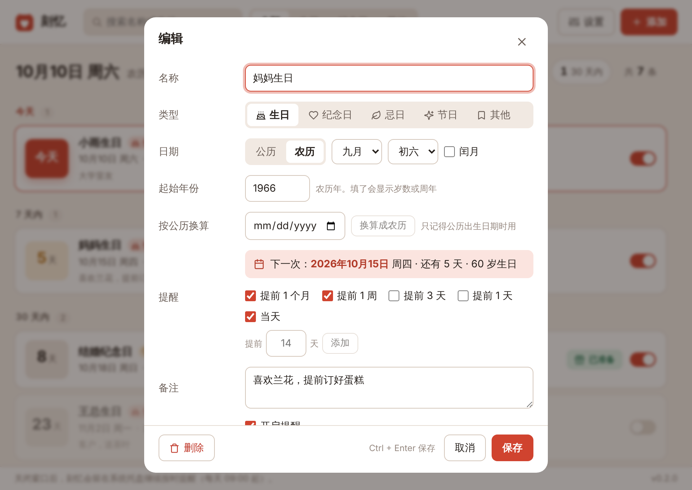
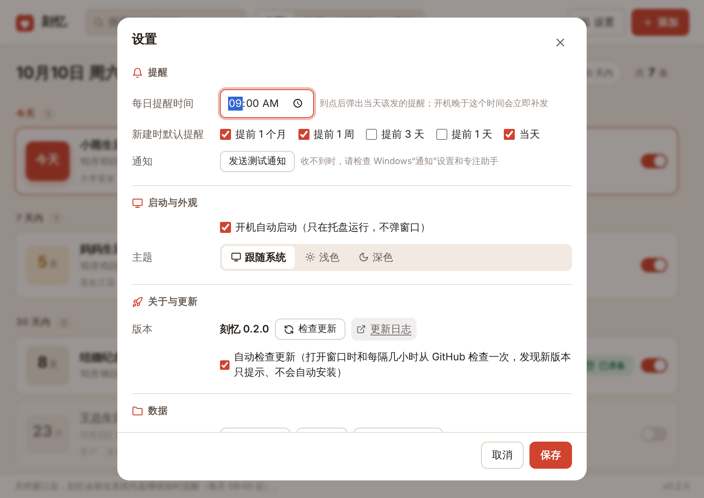
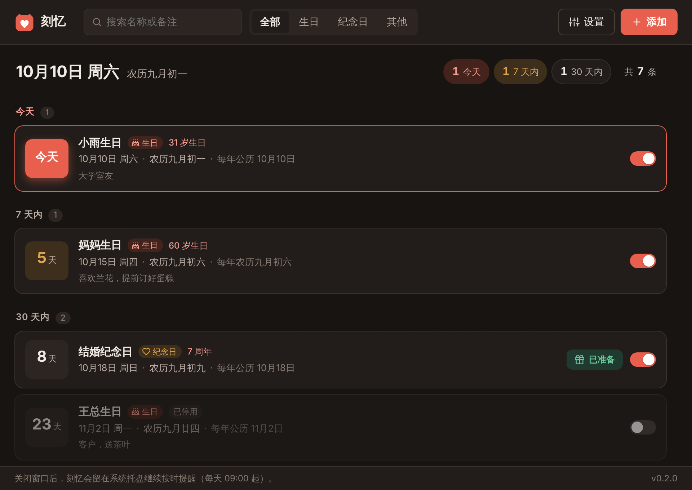

<div align="center">


# 刻忆 Daymark

**重要的日子，录入一次，每年都不会忘。**

生日、纪念日只记一次，农历自动换算成每年的公历日期，<br>
在提前 1 个月、1 周和当天主动弹出 Windows 通知。

[](https://github.com/kekemao00/daymark/releases/latest)
[](https://github.com/kekemao00/daymark/actions/workflows/ci.yml)
[](#下载安装)
[](LICENSE)



</div>

## 为什么做刻忆

手机日历能记公历生日，但长辈的农历生日每年对应的公历日期都不一样，常常要现查；
纪念日记得住日子，却总在当天才想起来，来不及准备礼物。

刻忆只做一件事：把这些日子记下来，**提前**提醒你。它常驻在系统托盘，开机自动启动，
关掉窗口也照常提醒，不需要你每天打开它看。

## 下载安装

到 [Releases](https://github.com/kekemao00/daymark/releases/latest) 下载 `Daymark_<版本>_x64-setup.exe`，双击安装即可。

- 支持 Windows 10 1809 及以上、Windows 11
- 装在当前用户下，不需要管理员权限；缺少 WebView2 时安装程序会自动下载
- 安装包暂未做代码签名，Windows SmartScreen 可能提示“已保护你的电脑”，点“更多信息 → 仍要运行”
- 装好以后不用再来这里：有新版本时刻忆会在窗口顶部提示，点“立即更新”自动下载安装并重启

## 功能

| | |
| --- | --- |
| 📅 **公历 / 农历双轨** | 农历支持闰月、大小月和“三十”，1901–2099 年与香港天文台农历表逐日一致；只记得公历出生日期也能一键换算成农历 |
| ⏰ **多级提前提醒** | 每条可选提前 30 / 7 / 3 / 1 天和当天，也可自定义 1–60 天内任意天数；默认提前 1 个月、1 周和当天 |
| 🎁 **已准备** | 礼物买好了就标记“已准备”，之后的提前提醒不再打扰，当天仍提醒一次；明年自动恢复 |
| 🔁 **错过自动补发** | 电脑没开错过的提醒，下次开机到点后补发一次，同一阶段不会重复打扰 |
| 🔔 **常驻托盘** | Windows Toast 通知、开机自启（只进托盘不弹窗）、关闭窗口继续提醒、单实例运行 |
| 👀 **一目了然** | 首页先告诉你今天几号、农历几号、今天 / 本周 / 本月各有几件事；列表按“今天 / 7 天内 / 30 天内 / 更晚”分组，显示倒数天数、岁数和周年，可搜索、按类型筛选 |
| ⬆️ **应用内更新** | 自动检查 GitHub 上的新版本，一键下载、校验签名、安装并重启；可关闭自动检查 |
| 🔒 **数据只在本机** | 不需要账号，除检查更新外不联网；原子写入并自动备份，可导出导入 |
| 🌗 **浅色 / 深色** | 跟随系统，或在设置里固定浅色 / 深色 |
| ⌨️ **键盘友好** | `Ctrl+N` 添加、`/` 搜索、`Ctrl+,` 设置、`Ctrl+Enter` 保存；删除可撤销 |

## 截图

<table>
  <tr>
    <td width="50%"></td>
    <td width="50%"></td>
  </tr>
  <tr>
    <td align="center">添加 / 编辑：选好农历日期，立刻看到下一次是哪天</td>
    <td align="center">设置：提醒时刻、开机自启、主题、更新、备份</td>
  </tr>
  <tr>
    <td width="50%"></td>
    <td width="50%"></td>
  </tr>
  <tr>
    <td align="center">深色模式：跟随系统或手动固定</td>
    <td align="center">有新版本时顶部提示，一键更新</td>
  </tr>
  <tr>
    <td colspan="2" align="center"><sub>截图中的人名与日期均为示例数据。</sub></td>
  </tr>
</table>

## 提醒是怎么工作的

1. 每天到了提醒时刻（默认 09:00，可在设置里改），刻忆检查每个条目处在哪个提醒阶段。
   例如提前量是“1 个月 / 1 周 / 当天”、离生日还剩 20 天，就处在“提前 1 个月”阶段。
2. 当前阶段还没提醒过，就弹出一条系统通知，文案写的是真实剩余天数（如“「妈妈生日」还有 5 天”）。
3. 开机晚于提醒时刻，会立即补发；但只补当前阶段，不会把已经过去的阶段一股脑全弹出来。
4. 刚新建或改过日期的条目，当天之前的阶段视为已跳过，不会一录入就弹窗。
5. 标记了“已准备”的条目，这一次剩下的提前提醒不再弹，当天仍提醒一次。

农历的几个边界情况：闰月条目当年没有闰月时按普通月提醒；农历三十在小月落到廿九；
公历 2 月 29 日在平年落到 2 月 28 日。详见 [docs/architecture.md](docs/architecture.md)。

## 数据与备份

所有数据保存在本机一个 JSON 文件里：

```
%APPDATA%\app.daymark.desktop\daymark.json
```

- 写入时先写临时文件再替换，同时保留上一份为 `.bak`；主文件损坏时自动从备份恢复
- 设置里可以“导出备份”到任意位置，换电脑时再“导入”，同一条目按修改时间合并；“打开数据目录”可直接定位文件

## 更新

刻忆会在打开窗口时（以及后台每隔几小时）检查 [GitHub Releases](https://github.com/kekemao00/daymark/releases) 上有没有新版本，
有的话在顶部横幅提示。点“立即更新”会下载安装包、校验签名、自动安装并重新打开，数据不受影响；点“稍后”一天内不再提示。
托盘菜单和设置里也可以手动检查；不想联网的话可以在设置里关掉自动检查。

## 路线图

- [x] **V0.1** Windows 桌面 MVP：公历 / 农历、多级提醒、托盘、开机自启、导入导出
- [x] **V0.2** 体验重做（今日概览、图标与类型色、撤销、快捷键、主题）、“已准备”、自定义提前天数、应用内更新、CI 自动发版
- [ ] **V0.3** 通知上的“稍后提醒 / 已准备”按钮、重要度分级与提醒强度、批量导入
- [ ] AI 生成祝福语
- [ ] 数据同步（先做同步文件夹方案），扩展到移动端和浏览器插件

本次体验审视与后续迭代的详细思路见 [docs/product-review-v0.2.md](docs/product-review-v0.2.md)；
完整的产品规划（定位、PRD、MVP 范围、技术选型）见 [docs/README.md](docs/README.md)。

## 参与开发

技术栈：[Tauri 2](https://tauri.app/) + Rust，界面用 React + TypeScript + Vite。

```
crates/daymark-core   核心逻辑（纯 Rust，不依赖 Tauri）：农历换算、下一次日期、提醒阶段、存储
src-tauri             Tauri 2 外壳：命令、提醒调度线程、托盘、开机自启
src                   界面（React + TypeScript）
scripts               农历数据表生成与逐日对照脚本
docs                  工程文档与截图
```

需要 Node.js 22+ 和 Rust（stable）。Windows 上还需要 WebView2（Win10/11 一般已自带）和
Visual Studio 生成工具（“使用 C++ 的桌面开发”）。

```bash
npm install
npm run tauri dev            # 启动桌面应用（调试版不会注册开机自启）
npm run dev                  # 只在浏览器里预览界面，使用内存示例数据
npm test                     # 前端单测
cargo test -p daymark-core   # 核心逻辑单测
npm run verify:lunar         # 农历 1901–2099 逐日对照
npm run tauri build          # 生成 Windows 安装包
npm run version:set -- 0.3.0 # 一次改齐所有版本号
```

发版：改版本号、写 `.github/release-notes/v<版本>.md`、推送 `v<版本>` 标签，GitHub Actions 会构建、签名并发布 Release，
已安装的用户会在应用内收到更新。签名密钥的生成与配置、在 Linux 上检查或交叉编译、发布前验收清单见
[docs/development.md](docs/development.md)。

## 许可

[MIT](LICENSE)
